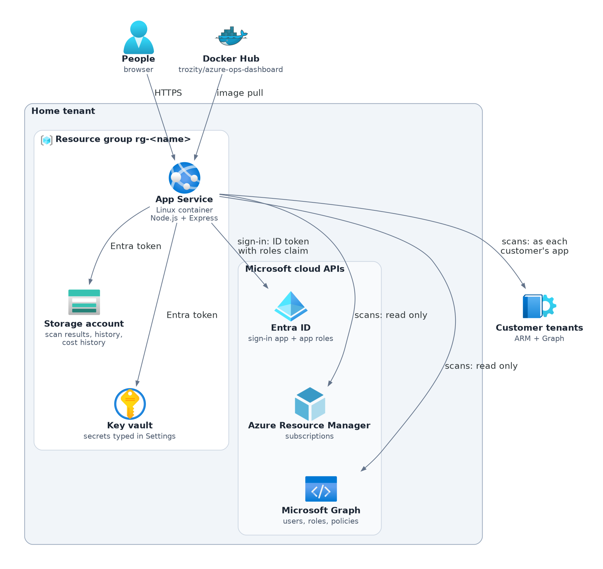
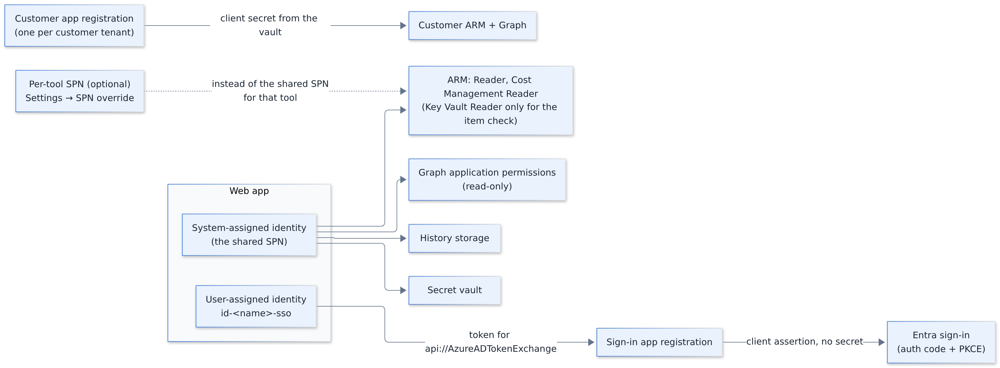
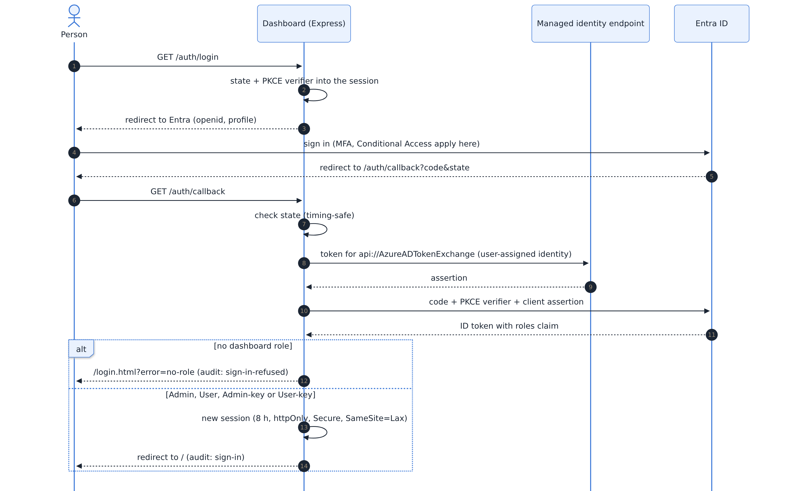
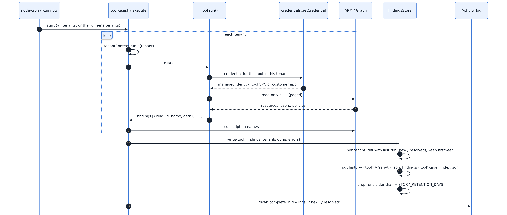
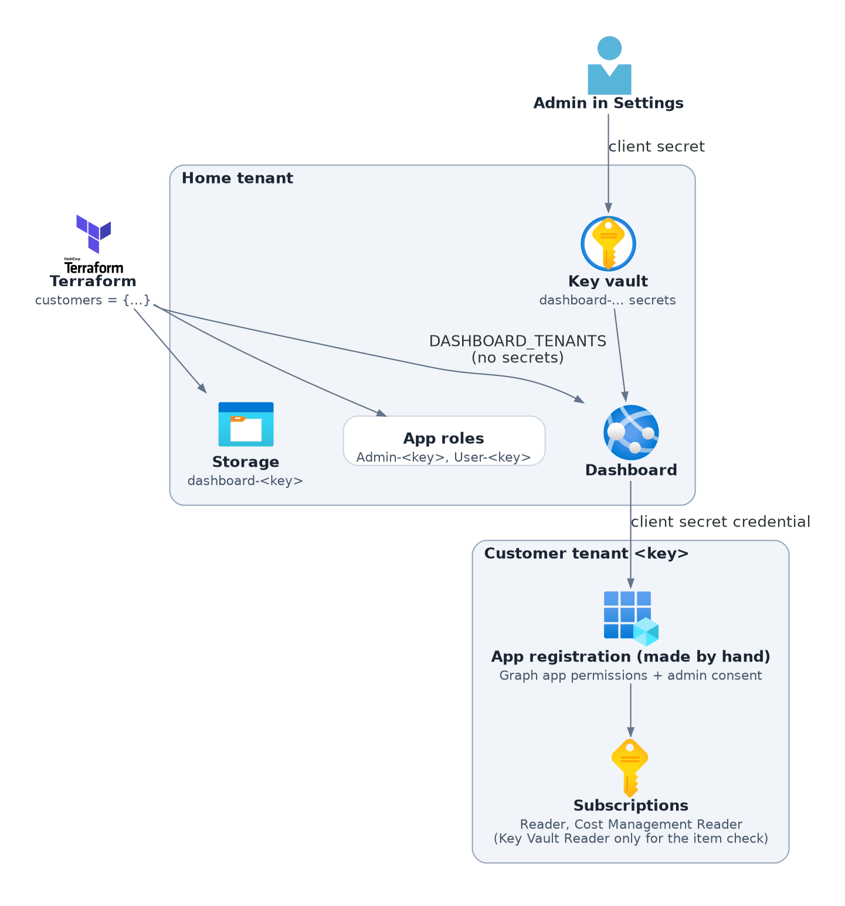
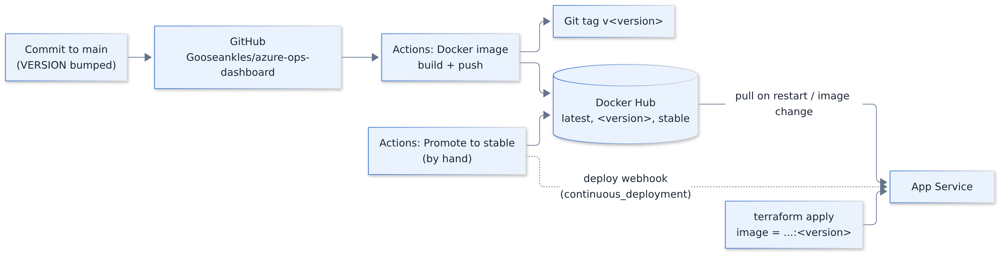
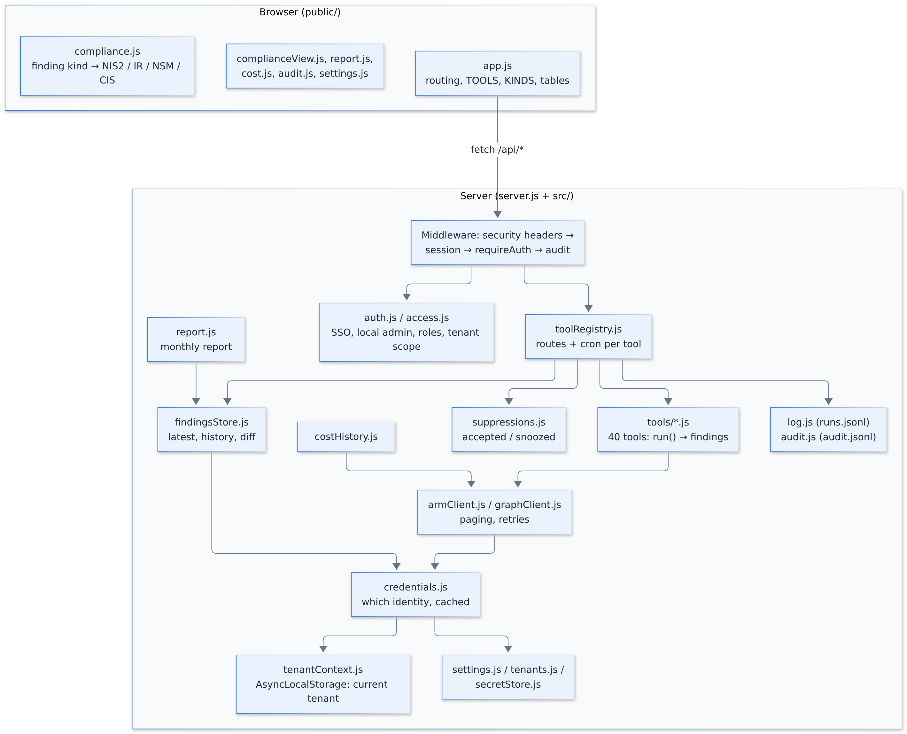
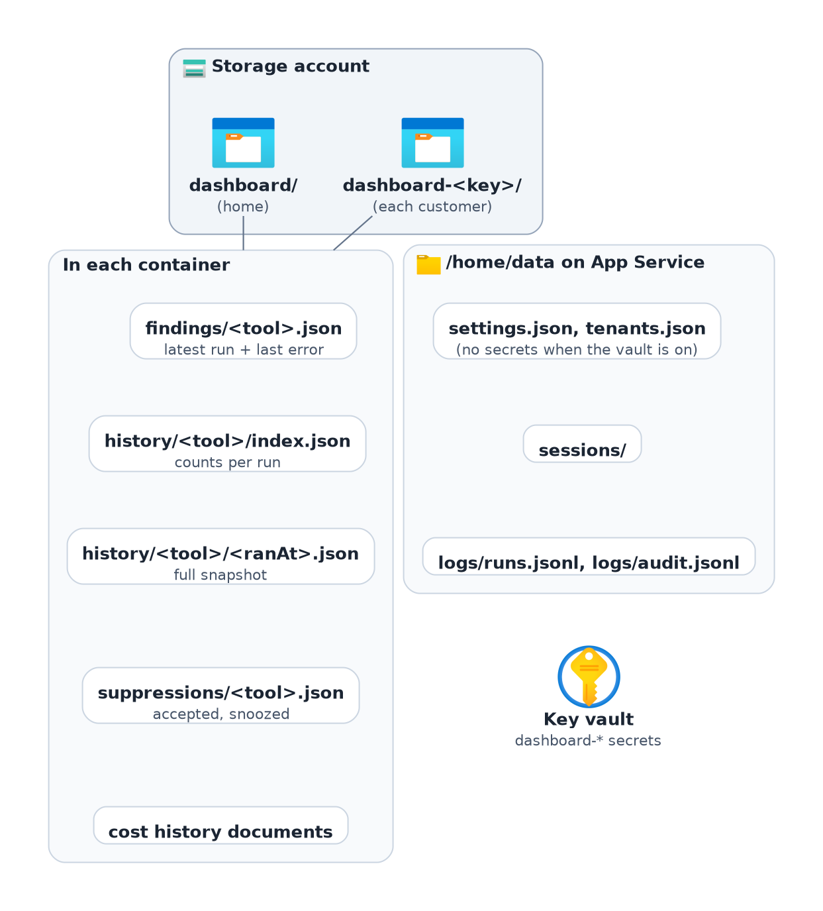

# Architecture

How the dashboard is built and deployed: first the big picture (high-level design), then the parts inside it
(low-level design). The diagrams are PNG pictures made from the sources next to them in `diagrams/` (Python with the official Azure icons for the building blocks, Mermaid text for sequences and flows). Names in `code` are settings, Terraform inputs or
files in this repo. Permissions per identity are listed in [permissions.md](permissions.md); every Terraform input
in the [Terraform module's README](https://github.com/Gooseankles/terraform-azurerm-ops-dashboard#readme).

- [1. Overview](#1-overview)
- [2. Azure resources (Terraform)](#2-azure-resources-terraform)
- [3. Identities: who talks to what](#3-identities-who-talks-to-what)
- [4. Signing in](#4-signing-in)
- [5. A scan run](#5-a-scan-run)
- [6. Customer tenants](#6-customer-tenants)
- [7. Network](#7-network)
- [8. Build and release](#8-build-and-release)
- [9. Inside the app (low-level design)](#9-inside-the-app-low-level-design)
- [10. Where data is kept](#10-where-data-is-kept)
- [11. Security controls in short](#11-security-controls-in-short)

## 1. Overview

One container on Azure App Service. People sign in with Entra ID; scheduled scans read Azure (ARM) and Entra
(Microsoft Graph) with the web app's managed identity, and store the results in a storage account. Nothing in Azure is
changed by the scans: every permission they use is a read permission.

Source: [arch-overview.py](diagrams/arch-overview.py)

| Part | What it is | Why |
|---|---|---|
| App Service (Linux) | One container, `always_on`, HTTPS only, TLS 1.2+ | Small, cheap, no servers to patch; the scheduler lives in the app |
| Container image | `node:26-alpine` (pinned by digest) without npm, runs as user `node`, port 7070 | Built by GitHub Actions on every push to `main`; pushed only if the Trivy scan finds no fixable critical or high problem |
| Storage account | Blob containers `dashboard` and `dashboard-<customer>` | Scan results and history survive restarts and redeploys; no account keys |
| Key vault | RBAC, soft delete, secrets named `dashboard-…` | Client secrets entered in Settings never sit on the app's disk |
| Sign-in app registration | Entra app with app roles, assignment required | Who may sign in and what they may do |
| Managed identities | System-assigned (scans, storage, vault) and user-assigned (SSO) | No secret exists for the home tenant |

## 2. Azure resources (Terraform)

The module lives in its own repo, [terraform-azurerm-ops-dashboard](https://github.com/Gooseankles/terraform-azurerm-ops-dashboard) (the module at its root,
a root configuration in `examples/default`). Dashed boxes are optional
(`create_history_storage`, `create_secret_vault`, `create_sso_app`, `create_role_groups`, `private_network`).

Source: [arch-azure-resources.py](diagrams/arch-azure-resources.py)

The image itself is not built by Terraform: the web app points at `image` (for example
`trozity/azure-ops-dashboard:0.18.0.0`) on Docker Hub and App Service pulls it.

App settings Terraform writes into the web app (the app reads them as environment variables):

| Setting | From |
|---|---|
| `AZURE_AUTH_TYPE=managed-identity` | Scans use the system-assigned identity |
| `DASHBOARD_AZURE_TENANT_ID`, `DASHBOARD_AZURE_CLIENT_ID`, `DASHBOARD_REDIRECT_URI` | Sign-in app |
| `DASHBOARD_FEDERATED_MI_CLIENT_ID` (or `DASHBOARD_AZURE_CLIENT_SECRET`) | Secretless SSO through the user-assigned identity |
| `STORAGE_ACCOUNT_URL`, `STORAGE_CONTAINER`, `HISTORY_RETENTION_DAYS` | History storage |
| `SECRET_VAULT_URL` | Secret vault |
| `DASHBOARD_TENANTS` | `customers` as JSON (no secrets) |
| `SESSION_SECRET` | `random_password`, kept in Terraform state |
| `DATA_DIR=/home/data`, `WEBSITES_PORT=7070` | App Service persistent storage and port |

## 3. Identities: who talks to what

Four kinds of identity. Only the customer apps use a secret, and that secret lives in the key vault.

Source: [arch-identities.py](diagrams/arch-identities.py)

- **Shared SPN** = the web app's system-assigned identity. All home-tenant scans use it unless a tool has its own
  SPN override (`<TOOL_ID>_AZURE_CLIENT_ID`). History storage can have its own override too (`history-storage`).
- **SSO**: the sign-in app has a federated credential that trusts the user-assigned identity, so MSAL signs its token
  request with that identity's token instead of a client secret.
- **Customer tenants**: Entra does not let an app trust a managed identity of another tenant, so each customer has
  its own app registration with a client secret, entered only in Settings and kept in the key vault.

## 4. Signing in

Source: [arch-sign-in.mmd](diagrams/arch-sign-in.mmd)

The break-glass local account (`admin` + `DASHBOARD_ADMIN_PASSWORD`) skips Entra and always has the Admin role; ten
wrong passwords from one address lock that address for 15 minutes.

What each role may do (`src/access.js`):

| Role | Tenants it sees | Areas | Settings, audit log |
|---|---|---|---|
| `Admin` | all | all | yes |
| `User` | all | all | no |
| `Admin-<key>` | that customer | all | no |
| `User-<key>` | that customer | all | no |
| `<Area>.Read` | all | that area | no |
| `<Area>.Read-<key>` | that customer | that area | no |

Areas are Identity, Platform, Security and Cost (`TOOL_AREAS` in `access.js`; a scan can be in several). Anyone who
may see a scan in a tenant may run it (Run now) and accept or snooze its findings there. `<Area>.Run` roles from
older versions count as `<Area>.Read`.

## 5. A scan run

Each scan tool has a cron schedule (for example MFA coverage daily at 05:50), and anyone who may see a scan can press **Run now**. One
run covers the home tenant and every enabled customer tenant, one after another.

Source: [arch-scan-run.mmd](diagrams/arch-scan-run.mmd)

A tenant that fails keeps its last results, with the error noted on them; the other tenants still save. A tenant
whose scan failed shows as "partly checked" on the Compliance page.

On read (`GET /api/tools/<id>/findings`) the app merges the tenants the person may see, adds subscription and tenant
names, and marks accepted or snoozed findings. Compliance tags are added in the browser (`public/compliance.js`).

## 6. Customer tenants

Source: [arch-customer-tenants.py](diagrams/arch-customer-tenants.py)

- Terraform never touches a customer tenant; `terraform output customer_onboarding` prints the consent link and role
  commands an admin there runs once.
- Each customer's results go to its own container, so removing a customer is deleting one container. Settings →
  Remove does that and the rest in one go (`src/tenantRemoval.js`): the secret and notification link purged from
  the vault, the container, its settings and activity-log lines, the tenant entry; nothing is kept. Its Entra roles
  and groups go when the key is removed from `customers` in Terraform; until then the app ignores the tenant
  (`DATA_DIR/removed-tenants.json`).
- A tenant delegated with Azure Lighthouse can instead be scanned by the home identity like any other subscription.

## 7. Network

Default: the site is public on `https://<name>.azurewebsites.net` and storage and vault have public endpoints,
reached only with Entra tokens. Three optional layers:

- `allowed_ip_ranges` / `allowed_subnet_ids`: App Service access restrictions; everything else is refused before it
  reaches the app (the Kudu site follows the same rules).
- `private_network = true`: the web app joins a VNet and reaches storage and vault through private endpoints, whose
  public access is turned off.
- `app_private_endpoint = true` (needs `private_network`): the web app itself gets an inbound private endpoint and
  its public address is turned off, so the site answers only inside the VNet and from networks joined to it (VPN,
  ExpressRoute or peering) that resolve `privatelink.azurewebsites.net`. Not together with the access restrictions
  or `continuous_deployment`.

Source: [arch-network.py](diagrams/arch-network.py)

With `vnet_route_all = true` all outbound traffic goes through the VNet, so that VNet needs a NAT gateway or a
firewall to reach Docker Hub, ARM and Graph. Two scans also fetch public data once a day (no tenant data is sent).
The End of support scan fetches dates from `endoflife.date`; if it is blocked, the scan uses its last copy or the
built-in dates. The Vulnerabilities (CVEs) scan fetches CISA's Known Exploited Vulnerabilities list from
`www.cisa.gov` and EPSS scores from `api.first.org` (only CVE ids are sent); if they are blocked, the scan uses its
last kept copy, otherwise it ranks by Defender's severity only. `CVE_FEEDS = off` makes neither call.

## 8. Build and release

Source: [arch-build-release.mmd](diagrams/arch-build-release.mmd)

- Versions are `major.minor.revision.package` (feature, small change, docs only). The image tag and the git tag carry
  the same number. The Terraform module has its own versions (`v<major>.<minor>.<patch>` in its repo); set
  `image = ...:<version>` to pin the app.
- `stable` is moved by hand once a build has proven itself; nothing is rebuilt, the same image gets one more tag.
  App Services deployed with the module's `continuous_deployment = true` pull it at once: the workflow calls each
  URL in the `STABLE_DEPLOY_WEBHOOKS` secret (the module's `deploy_webhook_url` output, one per line).
- `docker.yml` also runs every Tuesday so the image gets new base-image fixes; the Node base image is pinned by
  digest and Dependabot moves it.
- Pull requests build the image but do not push it.

## 9. Inside the app (low-level design)

No build step: the server is plain Node.js (CommonJS), the front end is plain JavaScript files served as they are.

Source: [arch-inside-app.mmd](diagrams/arch-inside-app.mmd)

### Tool contract

| Kind | Exports | Registered with | Routes |
|---|---|---|---|
| Scan | `{ id, label, schedule, run() }`, `run()` returns findings | `registerScanTool` | `POST /api/tools/<id>/run`, `/accept`, `/unaccept`; `GET /findings`, `/history`, `/history/<ranAt>` |
| Action | `{ id, label, registerRoutes(app) }` | `registerActionTool` | its own (Access lookup) |

A finding is a plain object: `kind` (drives label, severity and compliance tags), `id` (stable across runs, used to
diff), `name`, `detail`, and where it applies `subscriptionId`, `resourceGroup`, `principalId`. The store adds
`firstSeen`, and `tenant` for customer findings.

Adding a tool touches: `src/tools/<tool>.js`, `server.js` (register), `src/toolPermissions.js` (what it needs),
`src/settings.js` (SPN override and its settings), `public/app.js` (`TOOLS`, `KINDS`) and `public/compliance.js`
(controls per kind and `TOOL_KINDS`).

### Main API

| Route | Who | What |
|---|---|---|
| `GET /api/me` | anyone | Signed in?, roles, tenants, version |
| `GET /api/tools` | signed in | Tools and the permissions each needs |
| `GET /api/tools/<id>/findings` | signed in | Latest results for the tenants the person sees |
| `POST /api/tools/<id>/run` | Anyone who may see the scan in that tenant | Start a scan (202, runs in the background) |
| `GET /api/report?month=` | signed in | Monthly report |
| `GET /api/cost/history[/]` | signed in | Cost history |
| `GET/POST /api/settings`, `/api/tenants` | Admin | Settings and customer tenants (secrets go to the vault) |
| `POST /api/tenants/<key>/remove` | Admin | Delete a customer tenant and everything held for it (the body repeats the key); the reply lists what was deleted and what failed |
| `POST /api/tenants/<key>/restore`, `DELETE /api/tenants/<key>` | Admin | Undo a removed Terraform tenant (its data stays deleted); drop a Terraform tenant's Settings changes |
| `GET /api/audit` | Admin | Audit log |
| `GET /api/logs` | signed in | Activity log, filtered to the person's tenants |

## 10. Where data is kept

Source: [arch-data.py](diagrams/arch-data.py)

| Data | Kept | How long |
|---|---|---|
| Scan results and history | Blob (or `DATA_DIR`) | `HISTORY_RETENTION_DAYS`, default 365 |
| Cost history | Blob (or `DATA_DIR`) | As long as you like |
| Secrets typed in Settings | Key vault (or the JSON files when no vault) | Until changed |
| Settings, sessions | `/home/data` | Sessions 8 h |
| Activity log, audit log | `/home/data/logs` | Audit: `AUDIT_RETENTION_DAYS`, default 365 |

`/home` on App Service is persistent shared storage (`WEBSITES_ENABLE_APP_SERVICE_STORAGE=true`), so settings,
sessions and logs survive restarts and new images. With more than one instance they would be shared, but the
scheduler is in-process (every instance would run every scan), so run **one instance**: scale the plan up, not out.

## 11. Security controls in short

| Area | Control |
|---|---|
| Secrets | None for the home tenant (managed identities, federated credential); customer secrets only in the key vault; storage account keys off |
| Least privilege | Read-only ARM roles and Graph permissions; optional per-tool identities; the vault role is on that one vault |
| Sign-in | Entra with PKCE and state check; assignment required and an app role required; local admin rate-limited |
| Sessions | Server-side, httpOnly, Secure on HTTPS, SameSite=Lax, 8 hours, regenerated at sign-in |
| Browser | Strict Content-Security-Policy (own scripts only), no framing, nosniff, HSTS |
| Tenant isolation | One container per customer; every read and run checks the person's tenant scope |
| Traceability | Audit log of sign-ins, page views, lookups and changes (never secret values); activity log of every scan |
| Network | HTTPS only, TLS 1.2+, FTPS off; optional IP restrictions and private endpoints |
| Container | Alpine Node 26 with security updates, production dependencies only, no npm, runs as non-root `node`; Trivy scan before every push (results in the GitHub Security tab), Dependabot weekly |
