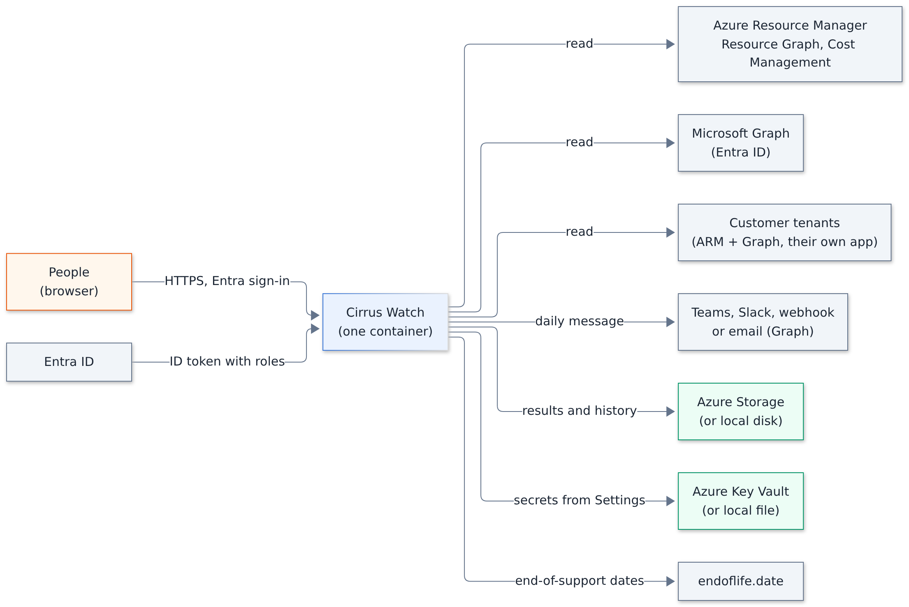
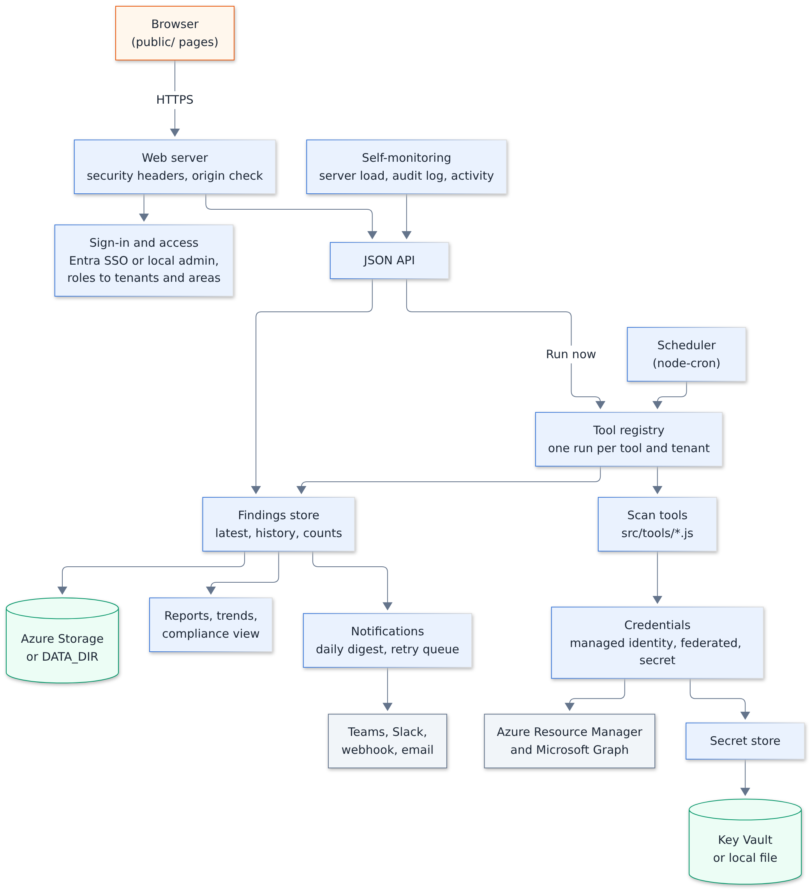
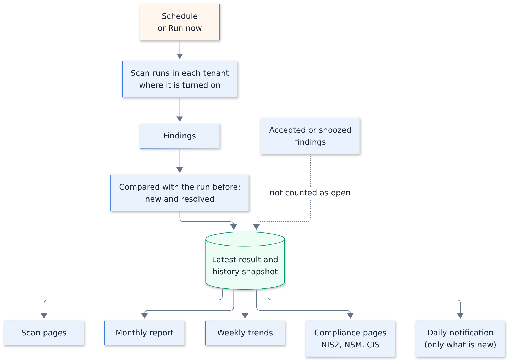
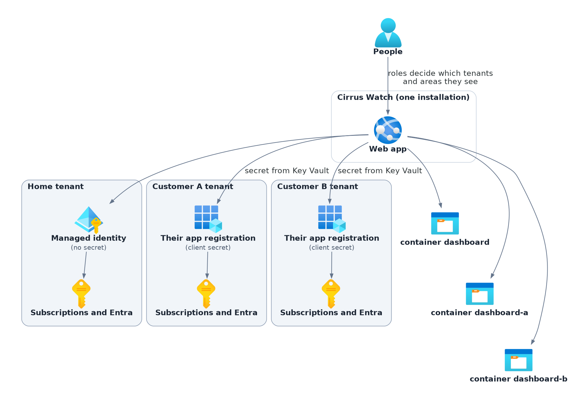
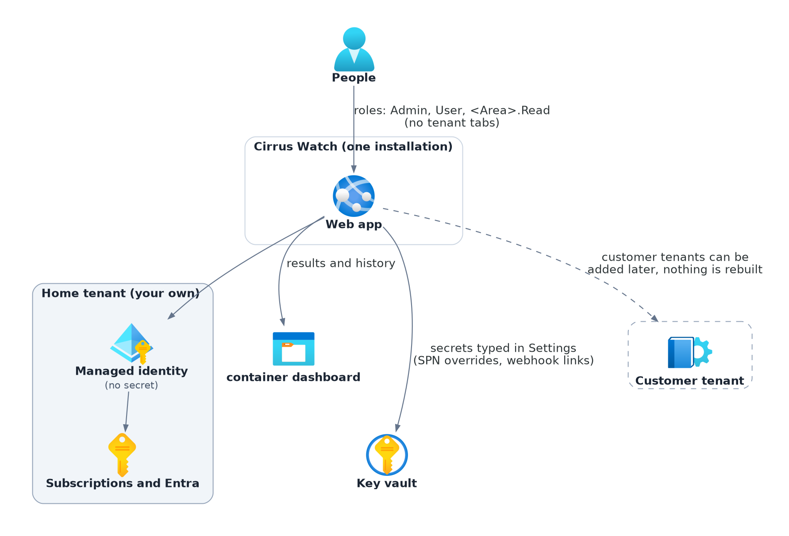
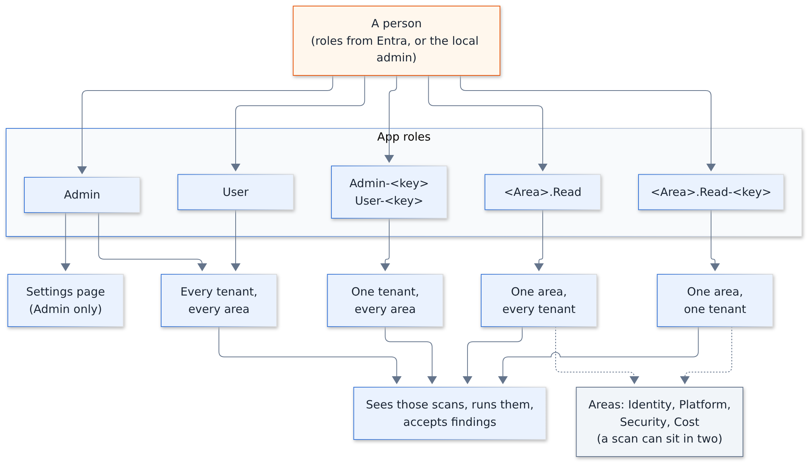

# High-level design

What Cirrus Watch is for, what it is made of, and the main choices behind it, on one page. The details are in
[architecture.md](architecture.md) (every part, with diagrams), the [setup low-level design](lld-setup.md) (what
the deployment creates and how a start-up, a sign-in and a scan run step by step) and the
[decision records](adr/README.md).

## Purpose

Teams that run Azure tenants repeat the same checks: what costs money for nothing, who has access to what, which
secrets expire, which resources break policy or are open to the internet. Cirrus Watch runs those checks on a
schedule, keeps every result so changes over time show, and puts them on one page per check, for one tenant or for
several customers' tenants.

## Who uses it

| Who | What they do |
| --- | --- |
| Admin (`Admin` role) | Sets it up, changes Settings, adds customer tenants, sees everything |
| Team member (`User`, `<Area>.Read`, `…-<key>` roles) | Reads the scans of their area or customer, runs them, accepts known findings |
| Customer contact | Receives the monthly report (Print / PDF) and the daily notifications |
| Whoever deploys it | Runs the Terraform module, or runs the container elsewhere |

## Scope

**In scope:** read-only checks of Azure Resource Manager, Cost Management and Microsoft Graph data; history and
trends; accepting findings; monthly report and compliance view (NIS2, NSM, CIS); daily notifications; several
tenants from one installation.

**Not in scope:** changing anything in a scanned tenant (the scans only read, see
[ADR 0001](adr/0001-scans-only-read.md)); real-time alerting (scans run on a schedule: most once a night, a few
weekly, resource health once an hour); being a SIEM or replacing Microsoft Defender for Cloud; proving compliance
(a missing finding does not prove a control is met).

## Context

Source: [hld-context.py](diagrams/hld-context.py)

Besides Azure, the app reads three public data sources, each at most once a day: endoflife.date for end-of-support
dates, and CISA's Known Exploited Vulnerabilities list and FIRST's EPSS scores to rank the CVEs that Defender for
Cloud found. No tenant data is sent (the EPSS lookup sends CVE ids only). When a source cannot be reached, the last
kept copy is used; the two CVE feeds can be turned off. The opt-in Domains and mail scan asks public DNS and RDAP
(`rdap.org` and the registries) about the tenant's own domain names, at most once a day.

## Building blocks

Source: [hld-building-blocks.mmd](diagrams/hld-building-blocks.mmd)

| Block | What it does | Where in the code |
| --- | --- | --- |
| Web server | Serves the pages and the JSON API; security headers, origin check | `server.js` |
| Sign-in and access | Entra SSO or local admin; roles to tenants and areas | `src/auth.js`, `src/access.js` |
| Scan tools | One module per check; each returns findings | `src/tools/*.js` ([tools.md](tools.md)) |
| Tool registry and scheduler | Runs each tool per tenant on its cron schedule or on Run now; keeps runs apart | `src/toolRegistry.js` |
| Credentials | Picks the identity per tool and tenant (managed identity, federated, secret) | `src/credentials.js` |
| Findings store | Latest results, history snapshots and counts, per tenant container | `src/findingsStore.js` |
| Secret store | Secrets in Key Vault, with a file fallback | `src/secretStore.js` |
| Reports | Monthly report, weekly trends, compliance view | `src/report.js`, `src/trends.js`, `public/compliance.js` |
| Notifications | Daily digest per tenant, retry queue | `src/notify.js` |
| Self-monitoring | Server load sampling and alarms, audit log, activity log | `src/monitor.js`, `src/audit.js`, `src/log.js` |
| Front end | No-build single page app | `public/` |

## From scan to report

A scan starts on its schedule or on **Run now**, reads the tenant, saves the findings and feeds every page and the daily message.

Source: [hld-scan-to-report.mmd](diagrams/hld-scan-to-report.mmd)

## Tenants

One installation watches the home tenant, alone or with any number of customer tenants. Each tenant has its own
identity for the scans (the home tenant a managed identity, a customer their own app registration) and its own
storage container; roles decide who sees which. Removing a customer in Settings deletes everything the dashboard
holds for it (secrets purged, container deleted, nothing kept); its roles and groups go when it is removed from
Terraform too.

Source: [hld-tenants.py](diagrams/hld-tenants.py)

## Single tenant or several

Most installations watch one tenant: their own. Nothing has to be turned off for that. Leave `customers` out of
Terraform; the module then makes no customer containers, roles or groups, and the app gets no `DASHBOARD_TENANTS`.
The web app scans the home tenant with its managed identity and keeps the results in the one container
`dashboard`. The roles are `Admin`, `User` and `<Area>.Read`. The pages show no tenant tabs. The key vault is still
made: it holds what is typed into Settings (a tool's own SPN secret, a webhook link); `create_secret_vault = false`
keeps those in files instead. Customer tenants can be added at any time without rebuilding anything
([setup low-level design, section 9](lld-setup.md#9-adding-a-customer-tenant)).

Source: [hld-single-tenant.py](diagrams/hld-single-tenant.py)

| What | Single tenant | With customer tenants |
| --- | --- | --- |
| Pick it when | You watch your own tenant (subscriptions delegated to you with Azure Lighthouse are scanned like your own; their Entra is not) | You watch other organizations' tenants from one installation |
| Scan identity | The managed identity, no secret | Plus each customer's own app registration, its client secret in the key vault |
| Roles | `Admin`, `User`, `<Area>.Read` | Plus `Admin-<key>`, `User-<key>`, `<Area>.Read-<key>` |
| Storage | One container, `dashboard` | One container per tenant |
| Pages | No tenant tabs | A tab per tenant and "All tenants" |

## Who sees what

Roles come from Entra (app roles on the sign-in app, given through groups). `Admin` and `User` reach every tenant
and every area; `Admin-<key>` and `User-<key>` reach one customer tenant; `<Area>.Read` reaches one area in every
tenant and `<Area>.Read-<key>` one area in one tenant. The areas are Identity, Platform, Security and Cost; a scan
can sit in two. Whoever may see a scan may also run it and accept its findings. Only `Admin` opens Settings, the
tenant list and the audit log. The local admin account always counts as `Admin`. Old `<Area>.Run` roles still
sign in and count as `<Area>.Read`.

Source: [hld-roles.mmd](diagrams/hld-roles.mmd)

## Main design choices

| Choice | Why | Record |
| --- | --- | --- |
| Scans only read | Safe to point at production and at customers; small permissions | [0001](adr/0001-scans-only-read.md) |
| Managed identity first, no secrets for the home tenant | Nothing to leak or rotate | [0002](adr/0002-managed-identity-first.md) |
| Secrets typed in Settings go to Key Vault, never into Terraform | Terraform state stays free of customer secrets | [0003](adr/0003-secrets-in-key-vault-not-terraform.md) |
| Access by area and by tenant, roles held in Entra | Each team sees its own scans; access is managed with Entra groups | [0004](adr/0004-access-areas.md) |
| Each customer tenant has its own app registration | Entra does not let an app trust another tenant's managed identity | [0005](adr/0005-customer-tenants-own-app-registration.md) |
| One process, one instance, files and blobs instead of a database | Few moving parts, cheap to run (a B1 plan is enough) | [0006](adr/0006-one-process-one-instance.md) |
| Four-part app version, semver for the module | One number per image; the module needs semver for `?ref=` pins | [0007](adr/0007-versioning.md) |
| AGPL-3.0 | Changes offered as a service stay open | [0008](adr/0008-agpl-licence.md) |

## Deployment options

| Option | What you get |
| --- | --- |
| Terraform module on App Service (recommended) | Everything in [lld-setup.md](lld-setup.md): managed identities, secretless SSO, storage, Key Vault, optional private network and alerts |
| Docker anywhere | The image with a volume for `DATA_DIR`; an Azure identity by secret, managed identity or federated credential in `.env` |
| From source | `npm start` with Node.js 22 or newer (the image uses 26); for development |

## Quality attributes

- **Security:** read-only scan roles, managed identities, PKCE sign-in, roles from Entra, origin check on changing
  requests, strict content security policy, secrets never returned by the API, audit log. See
  [SECURITY.md](../SECURITY.md) and [architecture section 11](architecture.md#11-security-controls-in-short).
- **Reliability:** a tenant that fails keeps its last results and does not stop the others; the app starts even
  when the vault is down and retries it every minute; failed notifications are retried every hour; Azure Monitor
  emails when CPU, memory or server errors stay high (`alert_emails`).
- **Data separation:** each customer tenant has its own storage container and its own roles; a person sees only
  the tenants and areas their roles reach.
- **Cost:** one small App Service plan, one storage account, one key vault; no database.
- **Limits:** one instance (scale up, not out); a scan goes through its tenants one after another; large
  tenants make long scans (the Server load page shows which).

## Risks and open points

- The compliance mapping is written by hand; a review date is kept in `.github/frameworks.json` and the weekly
  stack report flags new framework versions.
- Graph permissions granted to a managed identity reach its token only after up to 24 hours.
- A customer's client secret expires; their scans fail until a new one is pasted in Settings.
