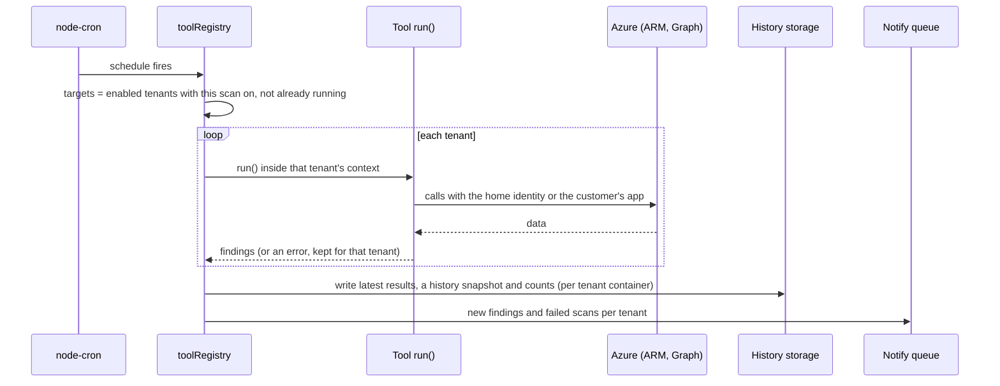

# Setup low-level design

What happens, step by step, when Cirrus Watch is deployed with the
[Terraform module](https://github.com/Gooseankles/terraform-azurerm-ops-dashboard) and then starts: which resources
are made and how they are wired, which settings the app gets, what the app does at start-up, how a sign-in and a
scan run, and what changes on an update. For the big picture see the [high-level design](hld.md) and [architecture.md](architecture.md); for every
permission see [permissions.md](permissions.md).

Names below use the module's defaults with `name = "contoso-ops"`. Everything a module input can turn off is
marked with that input.

## 1. What Terraform creates

| Resource | Default name | Made when | What it is for |
| --- | --- | --- | --- |
| Resource group | `rg-contoso-ops` | always (`resource_group_name` names it) | Holds everything below |
| App Service plan (Linux) | `asp-contoso-ops` | always (`sku_name`) | Runs the one container |
| Linux web app | `contoso-ops` | always | The dashboard; pulls `image` from Docker Hub |
| System-assigned identity on the web app | (none) | always | The **shared SPN**: scans, history storage, secret vault, Graph |
| User-assigned identity | `id-contoso-ops-sso` | always | Only for SSO: the sign-in app trusts it, so there is no client secret |
| Random password | (in state) | always | `SESSION_SECRET`, the key that signs sign-in cookies |
| Storage account + container `dashboard` | `st…` + random suffix | `create_history_storage` | Scan results, run history, cost history, accepted findings |
| Container `dashboard-<key>` per customer | (per customer) | `create_history_storage` and `customers` | One customer's data, apart from the others |
| Key vault | `kv…` + random suffix | `create_secret_vault` | Secrets typed into Settings (customer secrets, SPN overrides, notification links) |
| Sign-in app registration + enterprise app | `Cirrus Watch (contoso-ops)` | `create_sso_app` | SSO, with the app roles; assignment required |
| Federated credential on the sign-in app | `app-service-contoso-ops` | `create_sso_app` | Lets the user-assigned identity stand in for a client secret |
| Admin consent for `openid` and `profile` | (none) | `create_sso_app` and `grant_sso_consent` | Nobody sees "Need admin approval" at sign-in |
| App roles | `Admin`, `User`, `Admin-<key>`, `User-<key>`, `<Area>.Read[-<key>]` | `create_sso_app` | What each person may see ([sign-in and roles](guides/sign-in-and-roles.md)) |
| Security group per role | `Cirrus Watch (contoso-ops) <role>` | `create_role_groups` | Access is given by group membership |
| Graph application permissions on the shared SPN | (none) | `grant_graph_permissions` | The Entra scans (`graph_permissions` lists them) |
| Azure role assignments for the shared SPN | (none) | one per entry in `shared_spn_access` | Reader and Cost Management Reader on what is scanned |
| VNet, subnets, private endpoints, private DNS zones | `vnet-contoso-ops` … | `private_network` (`private_access`) | Storage and vault reachable only from the app |
| Action group + three metric alerts | `ag-contoso-ops` | `alert_emails` | Email when CPU, memory or HTTP errors stay high |

Terraform never touches a customer tenant. Each customer makes their own app registration by hand
(`terraform output customer_onboarding` prints the steps).

## 2. How the identities are wired

```mermaid
flowchart LR
  subgraph app["Web app contoso-ops"]
    sys["System-assigned identity<br/>(shared SPN)"]
    uai["User-assigned identity<br/>id-contoso-ops-sso"]
  end
  sso["Sign-in app registration<br/>Cirrus Watch (contoso-ops)"]
  arm["Subscriptions / management group"]
  graph["Microsoft Graph"]
  st["Storage account<br/>container dashboard"]
  kv["Key vault"]
  cust["Customer's own app registration<br/>(in their tenant, client secret)"]

  uai -- "federated credential<br/>(token for api://AzureADTokenExchange)" --> sso
  sys -- "Reader, Cost Management Reader" --> arm
  sys -- "Graph application permissions" --> graph
  sys -- "Storage Blob Data Contributor" --> st
  sys -- "Key Vault Secrets Officer" --> kv
  kv -. "holds the client secret of" .-> cust
```

- **Scans in the home tenant** use the system-assigned identity (`AZURE_AUTH_TYPE = managed-identity`, no client ID).
  A tool can get its own identity in Settings (SPN override); then it uses only that one.
- **Scans in a customer tenant** use that customer's app registration and the client secret stored in the key vault.
  History storage always stays on the home identity.
- **Sign-in** uses the sign-in app registration. Instead of a client secret, the app asks the user-assigned identity
  for a token with the audience `api://AzureADTokenExchange` and hands it to Entra as a client assertion. Entra
  accepts it because of the federated credential (issuer `https://login.microsoftonline.com/<tenant>/v2.0`, subject
  the identity's object ID).

## 3. The settings Terraform passes to the app

The web app's app settings become environment variables in the container. The app reads them through
`src/settings.js`; most can also be overridden on the Settings page (kept in `DATA_DIR/settings.json`).

| App setting | Value from Terraform | Read by |
| --- | --- | --- |
| `WEBSITES_PORT` | `7070` | App Service, to find the container's port |
| `WEBSITES_ENABLE_APP_SERVICE_STORAGE` | `true` | App Service: mounts the persistent `/home` share |
| `DATA_DIR` | `/home/data` | Settings, sessions, tenants, notifications, logs (survives restarts and image updates) |
| `SESSION_SECRET` | the random password | `src/sessionSecret.js` |
| `AZURE_AUTH_TYPE` | `managed-identity` | `src/credentials.js`: the shared SPN is the system-assigned identity |
| `DASHBOARD_AZURE_TENANT_ID` | the tenant Terraform runs in | `src/auth.js` |
| `DASHBOARD_AZURE_CLIENT_ID` | the sign-in app's client ID (made or given in `sso_app_client_id`) | `src/auth.js` |
| `DASHBOARD_REDIRECT_URI` | `https://contoso-ops.azurewebsites.net/auth/callback` | `src/auth.js`; also the origin check and the link in notifications |
| `DASHBOARD_FEDERATED_MI_CLIENT_ID` | the user-assigned identity's client ID (secretless SSO) | `src/auth.js` |
| `DASHBOARD_AZURE_CLIENT_SECRET` | `sso_client_secret`, only when SSO uses a secret | `src/auth.js` |
| `SECRET_VAULT_URL` | the vault URI (`create_secret_vault`) | `src/secretStore.js` |
| `STORAGE_ACCOUNT_URL`, `STORAGE_CONTAINER`, `HISTORY_RETENTION_DAYS` | blob endpoint, `dashboard`, `history_retention_days` (730) | `src/findingsStore.js` |
| `DASHBOARD_TENANTS` | JSON list of `customers` (key, name, tenant ID, client ID, subscriptions, enabled) | `src/tenants.js` |
| `AZURE_SUBSCRIPTION_IDS` | `scan_subscription_ids`, when set | the scans (blank = every subscription the identity can see) |
| `DASHBOARD_ADMIN_PASSWORD` | `admin_password`, when set | the local admin account |
| `DOCKER_ENABLE_CI` | `true` with `continuous_deployment` | App Service: pull the image when the deploy webhook is called |
| anything in `extra_app_settings` | as given | whatever reads it (`.env.example` lists every setting) |

`SESSION_SECRET`, `admin_password` and `sso_client_secret` sit in the Terraform state; keep the state private.
Customer client secrets never do: they are typed into Settings only.

## 4. What the app does when it starts

`node server.js` runs one process that serves the pages, answers the API, runs the scan schedules, samples its own
load and sends the notifications. Run exactly one instance ([ADR 0006](adr/0006-one-process-one-instance.md)).

```mermaid
sequenceDiagram
  participant S as server.js
  participant KV as Key vault
  participant FS as DATA_DIR
  S->>S: load .env (dotenv; App Service settings win)
  S->>FS: read settings.json, tenants.json (DASHBOARD_TENANTS merged in)
  S->>S: security headers, origin check for changing requests
  S->>FS: session store in DATA_DIR/sessions (memory if not writable)
  S->>S: sign-in key: SESSION_SECRET, else DATA_DIR/session-secret, else a new one
  S->>S: register every tool: routes, and a cron job per schedule
  S->>S: notifications: daily at NOTIFY_TIME, retry queue hourly
  S->>S: cost history cron (07:30), Server load sampler (every 15 s)
  S->>KV: load secrets (retry every minute until it answers)
  KV-->>S: secrets; any still in the JSON files move to the vault
  S->>S: listen on PORT (7070); warn if the admin password is short
```

Things to know:

- The pages and sign-in work before the vault has answered. A scan that needs a secret from the vault says the vault
  is not reachable, instead of asking for a secret that is there.
- A tool with no entry in `src/toolPermissions.js` or no area in `src/access.js` is reported in the log at start-up.
- Schedules use the container's time zone: UTC, unless a `TZ` app setting (for example through
  `extra_app_settings`) says otherwise.

## 5. A sign-in

```mermaid
sequenceDiagram
  participant B as Browser
  participant A as Cirrus Watch
  participant M as User-assigned identity
  participant E as Entra ID
  B->>A: GET /auth/login
  A->>A: new state and PKCE verifier, kept in the session
  A-->>B: redirect to Entra (openid profile)
  B->>E: sign in (MFA and Conditional Access apply here)
  E-->>B: redirect to /auth/callback?code&state
  B->>A: GET /auth/callback
  A->>M: token for api://AzureADTokenExchange
  M-->>A: assertion
  A->>E: code + verifier + assertion
  E-->>A: ID token with the roles claim
  A->>A: no dashboard role: refuse (login page says so); else new session
  A-->>B: redirect to /
```

The session lasts 8 hours without use and at most 24 hours. Roles live only in Entra; a change takes effect at the
next sign-in. The local admin account (`DASHBOARD_ADMIN_PASSWORD`) skips Entra and always has the Admin role.

## 6. A scheduled scan



- A tenant that fails keeps its last results, with the error shown on the scan page. Other tenants still run.
- **Run now** calls the same function for the tenants the person may see. A tenant already being scanned is
  skipped, so two runs never write the same results.
- Notifications go out once a day, not per scan.

## 7. Adding a customer tenant

1. The customer makes an app registration in their tenant with a client secret, grants the Graph application
   permissions (admin consent) and gives it Reader and Cost Management Reader on their subscriptions
   ([permissions](permissions.md#customer-tenant-app-other-tenants)).
2. You add them to `customers` in Terraform: key, name, tenant ID, client ID, subscriptions, members per role.
   Apply: the storage container `dashboard-<key>`, the roles `Admin-<key>`, `User-<key>` and any area roles, their
   groups and `DASHBOARD_TENANTS` are updated. The web app restarts with the new setting.
3. An Admin pastes the client secret in Settings → Customer tenants → Edit. It goes to the key vault.
4. **Test** checks the sign-in, the Graph permissions in the token and the roles on each subscription. The next
   scheduled run (or Run now) scans the new tenant.

## 8. With `private_network`

- The web app joins a subnet (outbound VNet integration).
- `private_access = "private_endpoint"` (default): the storage account and the vault get private endpoints and
  private DNS zones linked to the VNet, and their public network access is off.
- `private_access = "service_endpoint"`: no private endpoints; their firewalls let in only the integration subnet.
- `vnet_route_all` sends all outbound traffic through the VNet. Then the VNet needs a NAT gateway or firewall to reach
  Docker Hub, Entra, ARM and Graph.
- `allowed_ip_ranges` and `allowed_subnet_ids` limit who can reach the site; the Kudu (scm) site follows the same
  rules.

## 9. What an update changes

| Change | What happens |
| --- | --- |
| New image under the same tag (`:stable` promoted, `:latest` pushed) | With `continuous_deployment`, the deploy webhook makes App Service pull it and restart; without it, the next restart does |
| `image` set to another tag | Terraform updates the web app; it pulls that image and restarts |
| Module `?ref=` raised | Read the module [CHANGELOG](https://github.com/Gooseankles/terraform-azurerm-ops-dashboard/blob/main/CHANGELOG.md) Upgrading section first, then plan and apply |
| Any app setting changed | App Service restarts the container |

A restart keeps everything in `DATA_DIR` (on `/home`) and in the storage account. Sign-ins survive because the
sessions and the key are in `DATA_DIR` or `SESSION_SECRET`. Steps for upgrading, rolling back and backing up are in
[operations.md](operations.md).

## 10. Where it can go wrong

| Step | Symptom | See |
| --- | --- | --- |
| Federated credential or user-assigned identity missing | "gave no token" at sign-in | [Troubleshooting: sign-in](troubleshooting.md#sign-in) |
| Redirect URI differs from `DASHBOARD_REDIRECT_URI` | Entra error AADSTS50011 | [Troubleshooting: sign-in](troubleshooting.md#sign-in) |
| Graph permissions not granted or not yet in the token | Entra scans fail with 403 | [Troubleshooting: scans](troubleshooting.md#scans) |
| Vault or storage blocked by the network | "key vault is not reachable", history errors | [Troubleshooting: storage and secrets](troubleshooting.md#storage-and-secrets) |
| Two instances (scale-out) | Scans run twice, files fight | [ADR 0006](adr/0006-one-process-one-instance.md) |
