# Setup low-level design

What happens, step by step, when Cirrus Watch is deployed with the
[Terraform module](https://github.com/Gooseankles/terraform-azurerm-ops-dashboard) and then starts: which resources
are made and how they are wired, which settings the app gets, what the app does at start-up, how a sign-in, a
request and a scan run, where the data lives, and what changes on an update. For the big picture see the
[high-level design](hld.md) and [architecture.md](architecture.md); for every permission see
[permissions.md](permissions.md).

Names below use the module's defaults with `name = "contoso-ops"`. Everything a module input can turn off is
marked with that input.

## 1. What Terraform creates

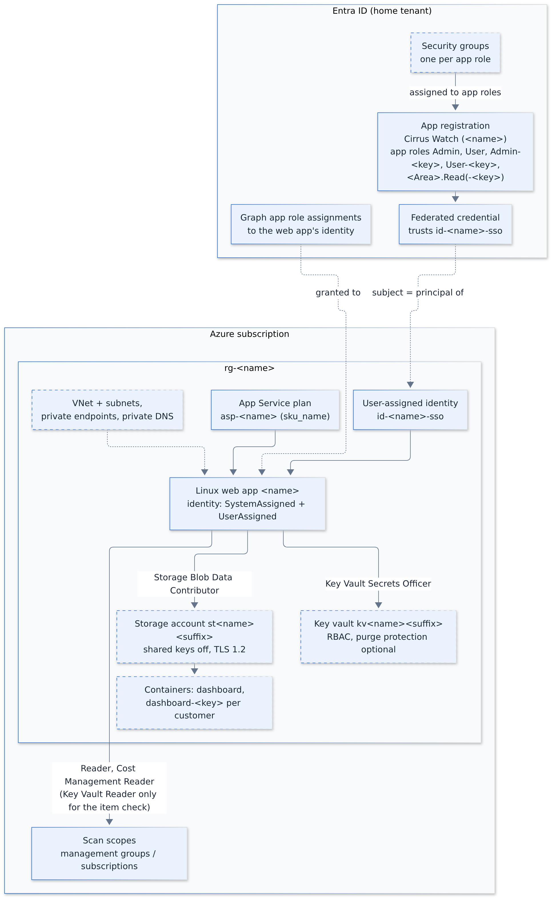

Source: [arch-azure-resources.py](diagrams/arch-azure-resources.py)

| Resource | Default name | Made when | What it is for |
| --- | --- | --- | --- |
| Resource group | `rg-contoso-ops` | always (`resource_group_name` names it) | Holds everything below |
| App Service plan (Linux) | `asp-contoso-ops` | always (`sku_name`) | Runs the one container |
| Linux web app | `contoso-ops` | always | The dashboard; pulls `image` from Docker Hub |
| System-assigned identity on the web app | (none) | always | The **shared SPN**: scans, history storage, secret vault, Graph |
| User-assigned identity | `id-contoso-ops-sso` | always | Only for SSO: the sign-in app trusts it, so there is no client secret |
| Random password | (in state) | always | `SESSION_SECRET`, the key that signs sign-in cookies |
| Storage account + container `dashboard` | `st…` + random suffix | `create_history_storage` | Scan results, run history, cost history, accepted findings |
| Container `dashboard-<key>` per customer | (per customer) | `create_history_storage` and `customers` | One customer's data, apart from the others |
| Key vault | `kv…` + random suffix | `create_secret_vault` | Secrets typed into Settings (customer secrets, SPN overrides, notification links) |
| Sign-in app registration + enterprise app | `Cirrus Watch (contoso-ops)` | `create_sso_app` | SSO, with the app roles; assignment required |
| Federated credential on the sign-in app | `app-service-contoso-ops` | `create_sso_app` | Lets the user-assigned identity stand in for a client secret |
| Admin consent for `openid` and `profile` | (none) | `create_sso_app` and `grant_sso_consent` | Nobody sees "Need admin approval" at sign-in |
| App roles | `Admin`, `User`, `Admin-<key>`, `User-<key>`, `<Area>.Read[-<key>]` | `create_sso_app` | What each person may see ([sign-in and roles](guides/sign-in-and-roles.md)) |
| Security group per role | `Cirrus Watch (contoso-ops) <role>` | `create_role_groups` | Access is given by group membership |
| Graph application permissions on the shared SPN | (none) | `grant_graph_permissions` | The Entra scans (`graph_permissions` lists them) |
| Azure role assignments for the shared SPN | (none) | one per entry in `shared_spn_access` | Reader and Cost Management Reader on what is scanned |
| Role assignments for the web app's own data | (none) | `create_history_storage`, `create_secret_vault` | Storage Blob Data Contributor on the storage account and Key Vault Secrets Officer on the vault, for the system-assigned identity |
| Key Vault Secrets Officer for named people | (none) | `create_secret_vault` and `secret_vault_admin_ids` | Break-glass: those users or groups may see and change the stored secrets in the portal; nobody else can |
| VNet, subnets, private endpoints, private DNS zones | `vnet-contoso-ops` … | `private_network` (`private_access`, `app_private_endpoint`) | Storage and vault reachable only from the app; with `app_private_endpoint` also the web app's own inbound endpoint `pe-contoso-ops`, so the site is reachable only from the VNet |
| Action group + three metric alerts | `ag-contoso-ops` | `alert_emails` | Email when CPU, memory or HTTP errors stay high |

Terraform never touches a customer tenant. Each customer makes their own app registration by hand
(`terraform output customer_onboarding` prints the steps).

### Single tenant

Many installations scan only the tenant they run in. Leave `customers` out; nothing else changes. Then no
`dashboard-<key>` container is made, the app roles and groups are only `Admin`, `User` and `<Area>.Read`, and the
`customer_containers` and `customer_onboarding` outputs are empty.

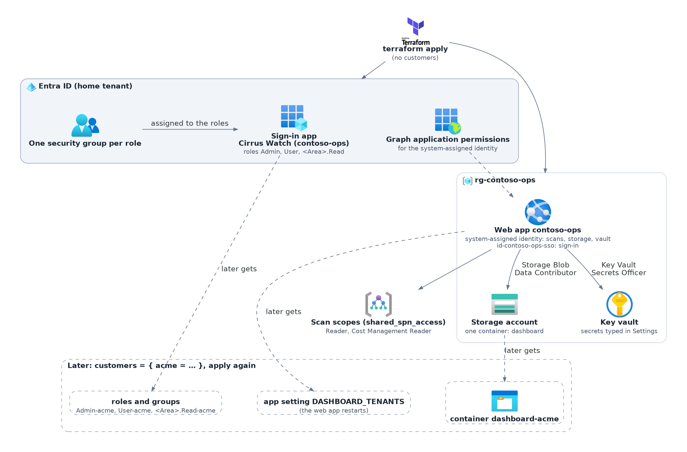

Source: [lld-single-tenant.py](diagrams/lld-single-tenant.py)

| What | Single tenant (no `customers`) | With customers |
| --- | --- | --- |
| Containers | `dashboard` | `dashboard`, plus `dashboard-<key>` per customer |
| App roles and groups | `Admin`, `User`, and `<Area>.Read` for each area in `area_roles` | Plus `Admin-<key>`, `User-<key>` and `<Area>.Read-<key>` per customer |
| App settings | No `DASHBOARD_TENANTS` | `DASHBOARD_TENANTS` lists the customers |
| Key vault | Made as before (`create_secret_vault`); holds the SPN override secrets and webhook links typed into Settings. `false` keeps them in `DATA_DIR` | Also each customer's client secret |
| Pages | No tenant tabs, no tenant name next to the rows. Settings → Customer tenants says "No customer tenants. Only this tenant is scanned." and keeps its Add tenant button | A tab per tenant and "All tenants"; the tenant list in Settings |

A customer can be added later without rebuilding anything (section 9).

## 2. How the identities are wired

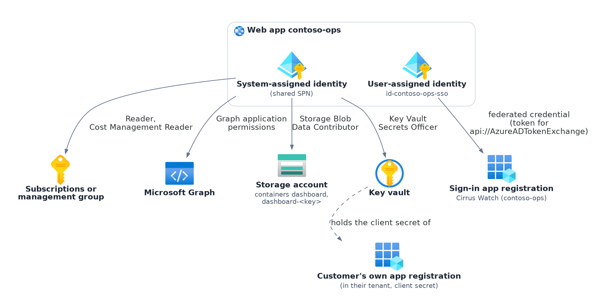

Source: [lld-identities.py](diagrams/lld-identities.py)

- **Scans in the home tenant** use the system-assigned identity (`AZURE_AUTH_TYPE = managed-identity`, no client ID).
  A tool can get its own identity in Settings (SPN override); then it uses only that one.
- **Scans in a customer tenant** use that customer's app registration and the client secret stored in the key vault.
- **Storage and the vault** always use the system-assigned identity: it writes the container `dashboard` and one
  `dashboard-<key>` per customer (Storage Blob Data Contributor) and reads and writes the vault's secrets
  (Key Vault Secrets Officer). A customer's app never touches them.
- **Sign-in** uses the sign-in app registration. Instead of a client secret, the app asks the user-assigned identity
  for a token with the audience `api://AzureADTokenExchange` and hands it to Entra as a client assertion. Entra
  accepts it because of the federated credential (issuer `https://login.microsoftonline.com/<tenant>/v2.0`, subject
  the identity's object ID).
- **Single tenant:** the second point does not apply; the others are the same. The vault then holds the SPN
  override secrets and webhook links typed into Settings.

## 3. The settings Terraform passes to the app

The web app's app settings become environment variables in the container. The app reads them through
`src/settings.js`; most can also be overridden on the Settings page (kept in `DATA_DIR/settings.json`).

| App setting | Value from Terraform | Read by |
| --- | --- | --- |
| `WEBSITES_PORT` | `7070` | App Service, to find the container's port |
| `WEBSITES_ENABLE_APP_SERVICE_STORAGE` | `true` | App Service: mounts the persistent `/home` share |
| `DATA_DIR` | `/home/data` | Settings, sessions, tenants, notifications, logs (survives restarts and image updates) |
| `SESSION_SECRET` | the random password | `src/sessionSecret.js` |
| `AZURE_AUTH_TYPE` | `managed-identity` | `src/credentials.js`: the shared SPN is the system-assigned identity |
| `DASHBOARD_AZURE_TENANT_ID` | the tenant Terraform runs in | `src/auth.js` |
| `DASHBOARD_AZURE_CLIENT_ID` | the sign-in app's client ID (made or given in `sso_app_client_id`) | `src/auth.js` |
| `DASHBOARD_REDIRECT_URI` | `https://contoso-ops.azurewebsites.net/auth/callback` | `src/auth.js`: where Entra sends the sign-in back, and the return address after logout. An `https://` value also turns on Secure cookies and `trust proxy` in `server.js`, and `src/notify.js` builds the link in messages from it |
| `DASHBOARD_FEDERATED_MI_CLIENT_ID` | the user-assigned identity's client ID (secretless SSO) | `src/auth.js` |
| `DASHBOARD_AZURE_CLIENT_SECRET` | `sso_client_secret`, only when SSO uses a secret | `src/auth.js` |
| `SECRET_VAULT_URL` | the vault URI (`create_secret_vault`) | `src/secretStore.js` |
| `STORAGE_ACCOUNT_URL`, `STORAGE_CONTAINER`, `HISTORY_RETENTION_DAYS` | blob endpoint, `dashboard`, `history_retention_days` (730) | `src/findingsStore.js` |
| `DASHBOARD_TENANTS` | JSON list of `customers` (key, name, tenant ID, client ID, subscriptions, enabled); not set without customers | `src/tenants.js` |
| `AZURE_SUBSCRIPTION_IDS` | `scan_subscription_ids`, when set | the scans (blank = every subscription the identity can see) |
| `DASHBOARD_ADMIN_PASSWORD` | `admin_password`, when set | the local admin account |
| `DOCKER_ENABLE_CI` | `true` with `continuous_deployment` | App Service: pull the image when the deploy webhook is called |
| anything in `extra_app_settings` | as given | whatever reads it (`.env.example` lists every setting) |

`SESSION_SECRET`, `admin_password` and `sso_client_secret` sit in the Terraform state; keep the state private.
Customer client secrets never do: they are typed into Settings only.

## 4. What the app does when it starts

`node server.js` runs one process that serves the pages, answers the API, runs the scan schedules, samples its own
load and sends the notifications. Run exactly one instance ([ADR 0006](adr/0006-one-process-one-instance.md)).

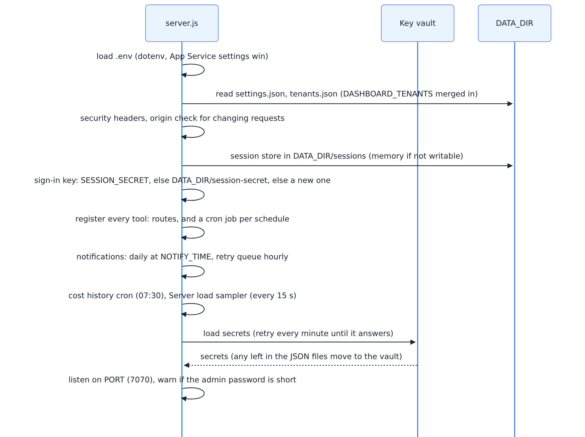

Source: [lld-startup.mmd](diagrams/lld-startup.mmd)

Things to know:

- The pages and sign-in work before the vault has answered. A scan that needs a secret from the vault says the vault
  is not reachable, instead of asking for a secret that is there.
- A tool with no entry in `src/toolPermissions.js` or no area in `src/access.js` is reported in the log at start-up.
- Schedules use the container's time zone: UTC, unless a `TZ` app setting (for example through
  `extra_app_settings`) says otherwise.
- Sign-ins are files in `DATA_DIR/sessions`. When that folder cannot be written, the app logs a warning and keeps
  them in memory; they are then lost at the next restart.
- A `SESSION_SECRET` shorter than 32 characters (or a placeholder) is ignored; the app makes its own key and keeps
  it in `DATA_DIR/session-secret`.

## 5. A sign-in

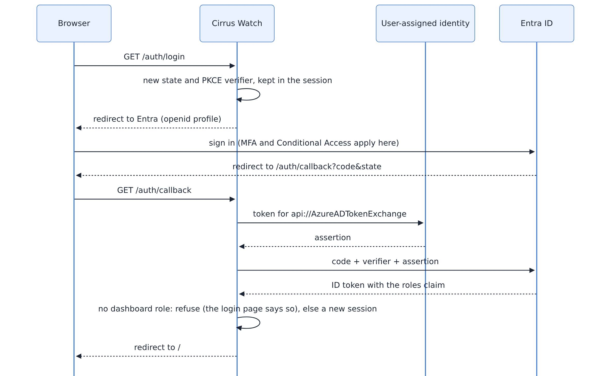

Source: [lld-sign-in.mmd](diagrams/lld-sign-in.mmd)

The session lasts 8 hours without use and at most 24 hours. Roles live only in Entra; a change takes effect at the
next sign-in. A person with no app role is refused at the login page. The local admin account
(`DASHBOARD_ADMIN_PASSWORD`) skips Entra and always has the Admin role; after ten wrong passwords from one address
that address must wait 15 minutes. On an `https://` site the session cookie is marked Secure.

## 6. The path of a request

Every request from the browser goes through the same chain of checks in `server.js` before a route answers it.

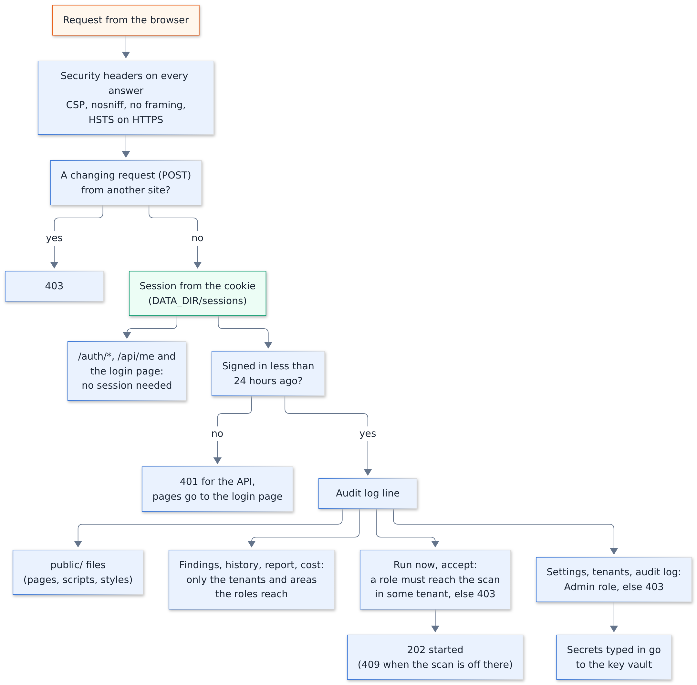

Source: [lld-request-path.mmd](diagrams/lld-request-path.mmd)

- Every answer carries the security headers: a content security policy that allows only the site itself, no
  framing, no content sniffing, and HSTS on HTTPS.
- A changing request (anything but GET, HEAD or OPTIONS) whose `Sec-Fetch-Site` or `Origin` header points at another
  site gets 403.
- Only `/auth/*`, `/api/me` and the login page work without a session. Everything else needs one that is less
  than 24 hours old: API calls get 401, pages are sent to the login page.
- Reading routes (findings, history, report, cost) return only the tenants and areas the roles reach.
- **Run now** and accepting a finding need a role that reaches that scan in at least one tenant, else 403. Run now
  answers 202 when the scan has started, or 409 when the scan is turned off in that tenant.
- Settings, the tenant list and the audit log need the `Admin` role, else 403. Secrets typed into Settings go to
  the key vault and are never sent back by the API.

## 7. A scheduled scan

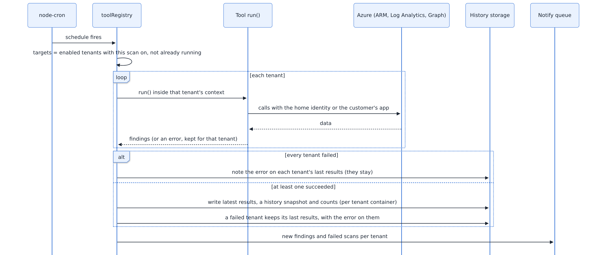

Source: [lld-scan.mmd](diagrams/lld-scan.mmd)

- A scan goes through its tenants one after another. A tenant that fails keeps its last results, with the error
  shown on the scan page. Other tenants still run. When every tenant fails, nothing new is written; the error is
  noted on each tenant's last results.
- **Run now** calls the same function for the tenants the person's roles reach. A tenant already being scanned is
  skipped, so two runs never write the same results. A tenant where the scan is turned off is skipped too.
- Each run writes the latest result, a history snapshot and the counts for the trend pages, per tenant container.
  Snapshots older than `HISTORY_RETENTION_DAYS` are removed.
- Notifications go out once a day at `NOTIFY_TIME` (08:30 by default), not per scan. A message that fails is
  retried every hour.

## 8. Where the data lives

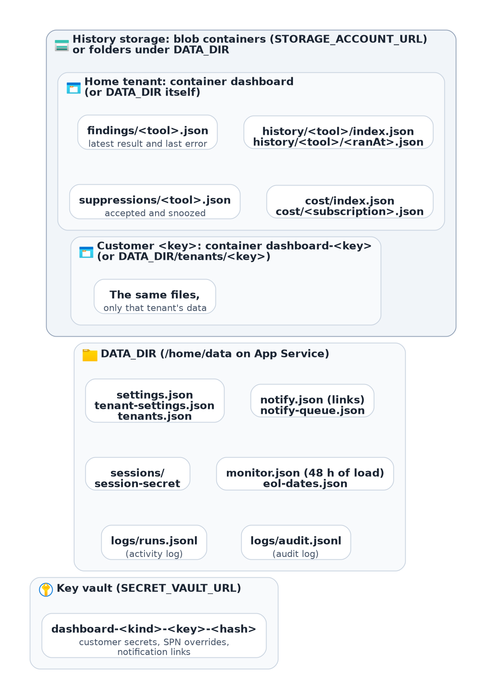

Source: [lld-storage-layout.py](diagrams/lld-storage-layout.py)

- **Scan data** sits in blob containers when `STORAGE_ACCOUNT_URL` is set, else in folders: the home tenant in
  the container `dashboard` (or `DATA_DIR` itself), each customer in `dashboard-<key>` (or
  `DATA_DIR/tenants/<key>`). Each holds the latest result and last error per scan (`findings/`), the history
  snapshots (`history/`), accepted and snoozed findings (`suppressions/`) and the cost history (`cost/`).
- **`DATA_DIR`** (`/home/data` on App Service) holds the settings, the tenant list, notification links and the
  retry queue, sessions and the session key, 48 hours of load samples, the end-of-life dates, the activity log and
  the audit log (`logs/audit.jsonl`, kept `AUDIT_RETENTION_DAYS`, 365 by default). `removed-tenants.json` lists
  customer tenants removed in Settings that Terraform still sets (section 9); the file goes when the list is empty.
- **The key vault** holds the secrets typed into Settings, named `dashboard-<kind>-<key>-<hash>`: customer client
  secrets, SPN overrides and notification links (only the last two in a single-tenant setup). Without a vault they
  stay in `DATA_DIR` (`settings.json`, `tenants.json`); the Settings page shows which of the two is in use.

## 9. Adding a customer tenant

A single-tenant installation becomes a multi-tenant one the same way; nothing is rebuilt. The apply adds the
container, the roles, the groups and the `DASHBOARD_TENANTS` app setting next to what is there, and the web app
restarts because an app setting changed. The home tenant's results stay in `dashboard`. The tenant tabs appear as
soon as a person may see more than one tenant. A tenant can also be added in Settings only (Add tenant): the app
then makes its container at the first write, but there are no `Admin-<key>` or `User-<key>` roles for it, so only
`Admin` and `User` see it.

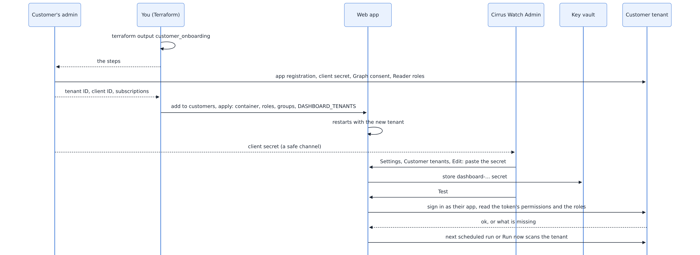

Source: [lld-customer.mmd](diagrams/lld-customer.mmd)

1. The customer makes an app registration in their tenant with a client secret, grants the Graph application
   permissions (admin consent) and gives it Reader and Cost Management Reader on their subscriptions
   ([permissions](permissions.md#customer-tenant-app-other-tenants)).
2. You add them to `customers` in Terraform: key, name, tenant ID, client ID, subscriptions, members per role.
   Apply: the storage container `dashboard-<key>`, the roles `Admin-<key>`, `User-<key>` and any area roles, their
   groups and `DASHBOARD_TENANTS` are updated. The web app restarts with the new setting.
3. An Admin pastes the client secret in Settings → Customer tenants → Edit. It goes to the key vault.
4. **Test** checks the sign-in, the Graph permissions in the token and the roles on each subscription. The next
   scheduled run (or Run now) scans the new tenant.

### Removing a customer tenant

Settings → Customer tenants → **Remove** (`Admin` only; `Admin-<key>` cannot) deletes everything the app holds for
the tenant, with nothing kept (`src/tenantRemoval.js`, route `POST /api/tenants/<key>/remove`). The dialog lists
what goes, says it cannot be undone and asks for the tenant's key typed back. The steps run in this order, each on
its own, so one that fails does not stop the rest:

1. The tenant entry leaves `tenants.json` and, for a Terraform tenant, its key goes on `removed-tenants.json`.
   From here on `tenants.byKey()` does not find it, so it is not listed, scanned or shown, and the findings store
   drops any write for it (a scan still running cannot make its container again).
2. Its client secret is deleted from the vault and purged from the soft-delete bin (`DELETE /secrets/<name>`, then
   `DELETE /deletedsecrets/<name>` once the bin lists it). The web app's role on the vault, Key Vault Secrets
   Officer, includes the purge right; only `secret_vault_purge_protection` stops it, and then the page says the
   vault keeps the secret for the soft-delete period (90 days). Without a vault the secret went with the entry.
3. Its notification link (also a vault secret) is purged the same way, and its retry queue is dropped.
4. Its container `dashboard-<key>` is deleted (`DELETE ?restype=container`; blob soft delete does not cover
   containers, so this is final), or the folder `DATA_DIR/tenants/<key>` is removed.
5. Its entry in `tenant-settings.json` goes.
6. Cached subscription names and the cached sign-in with its secret are dropped.
7. Its lines in the activity log (`runs.jsonl` entries with `tenant: <key>`) are removed; lines about a whole run
   stay.

The audit log records `remove-tenant` with who, when and what each step did. The reply names what was deleted
and what failed, and the page shows it. What the app cannot delete: the customer's roles and groups in Entra
(Terraform made them; the app has no write permission in Entra), the `DASHBOARD_TENANTS` setting, and the
customer's own app registration. For a Terraform tenant the page therefore says to remove the key from
`customers` and apply; until then the tenant is ignored and listed as "Removed, waiting for Terraform" with
**Undo** (`POST /api/tenants/<key>/restore`: back on the list, data not restored). At start-up a removed key that
is no longer in `DASHBOARD_TENANTS` clears itself. **Reset** on a Terraform tenant (`DELETE /api/tenants/<key>`)
only drops its Settings changes.

## 10. With `private_network`

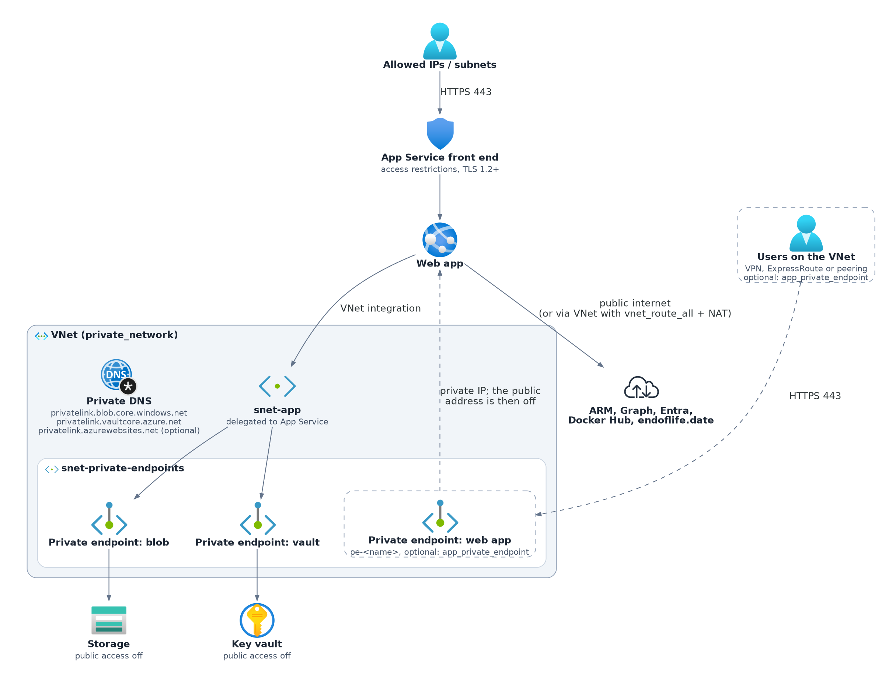

Source: [arch-network.py](diagrams/arch-network.py)

- The web app joins a subnet (outbound VNet integration).
- `private_access = "private_endpoint"` (default): the storage account and the vault get private endpoints and
  private DNS zones linked to the VNet, and their public network access is off.
- `private_access = "service_endpoint"`: no private endpoints; their firewalls let in only the integration subnet.
- `vnet_route_all` sends all outbound traffic through the VNet. Then the VNet needs a NAT gateway or firewall to reach
  Docker Hub, Entra, ARM and Graph.
- `allowed_ip_ranges` and `allowed_subnet_ids` limit who can reach the site; the Kudu (scm) site follows the same
  rules. `allowed_subnet_ids` keeps the public address and lets in subnets with the `Microsoft.Web` service endpoint;
  it creates no private endpoint.
- `app_private_endpoint = true`: the web app itself gets an inbound private endpoint (`pe-<name>`) in the private
  endpoint subnet and its public network access is off, for the site and the scm site. A
  `privatelink.azurewebsites.net` zone is created and linked to the VNet, or `app_private_dns_zone_id` points at an
  existing hub zone. Needs `private_network = true`; refused together with `allowed_ip_ranges`, `allowed_subnet_ids`
  or `continuous_deployment`. Works with either `private_access` (with `"service_endpoint"` the private endpoint
  subnet is then created too, or set `private_endpoint_subnet_id` with an existing VNet). The `private_network`
  output gains `app_endpoint_id`, `app_private_ip` and `app_public_access`.
- With it, people need a network path to the VNet (VPN, ExpressRoute or peering) and DNS that resolves
  `privatelink.azurewebsites.net` (on-premises DNS forwards it to Azure, for example through a Private DNS Resolver).
  SSO keeps working: the redirect goes through their browser, which is on that network.
- Subnet sizes: the integration subnet needs one address per app instance, twice that for a while during a scale
  operation or platform upgrade, and Azure keeps 5 addresses in every subnet. A /28 (11 usable) is enough for this
  app on one or a few instances; /26 if the plan scales out a lot or the subnet is shared. The private endpoint
  subnet holds up to three endpoints, so a /28 is plenty there.

## 11. What an update changes

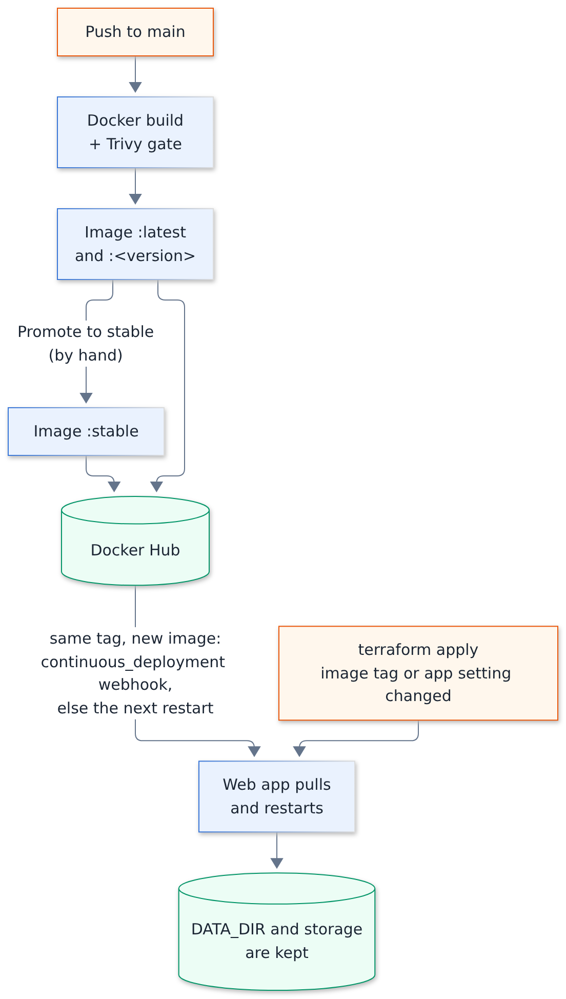

Source: [lld-update.mmd](diagrams/lld-update.mmd)

Every push to the app's main branch builds the image and, once the Trivy scan passes, pushes it as `:latest` and
`:<version>`; a `v*` git tag adds that version as a tag too. `:stable` moves only by hand (the promote workflow),
which then calls the deploy webhooks it knows.

| Change | What happens |
| --- | --- |
| New image under the same tag (`:stable` promoted, `:latest` pushed) | With `continuous_deployment`, the deploy webhook makes App Service pull it and restart; without it, the next restart does |
| `image` set to another tag | Terraform updates the web app; it pulls that image and restarts |
| `continuous_deployment` turned on or off | Also turns the Kudu site's basic authentication on or off: the deploy webhook signs in with the publishing credentials (FTP stays off) |
| Module `?ref=` raised | Read the module [CHANGELOG](https://github.com/Gooseankles/terraform-azurerm-ops-dashboard/blob/main/CHANGELOG.md) Upgrading section first, then plan and apply |
| Any app setting changed | App Service restarts the container |

A restart keeps everything in `DATA_DIR` (on `/home`) and in the storage account. Sign-ins survive because the
sessions and the key are in `DATA_DIR` or `SESSION_SECRET`. Steps for upgrading, rolling back and backing up are in
[operations.md](operations.md).

## 12. Where it can go wrong

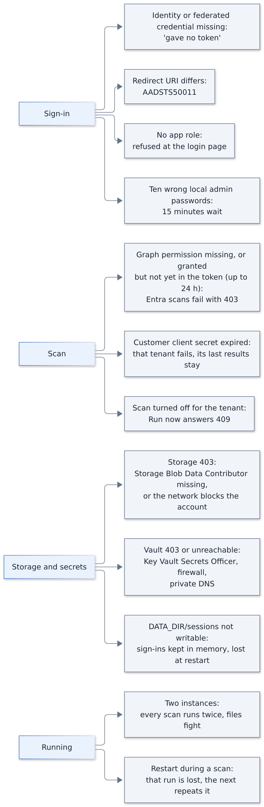

Source: [lld-failure-points.mmd](diagrams/lld-failure-points.mmd)

| Step | Symptom | See |
| --- | --- | --- |
| Federated credential or user-assigned identity missing | "gave no token" at sign-in | [Troubleshooting: sign-in](troubleshooting.md#sign-in) |
| Redirect URI differs from `DASHBOARD_REDIRECT_URI` | Entra error AADSTS50011 | [Troubleshooting: sign-in](troubleshooting.md#sign-in) |
| Person has no app role (not in a group) | Refused at the login page | [Sign-in and roles](guides/sign-in-and-roles.md) |
| Ten wrong local admin passwords from one address | Sign-in refused for 15 minutes | [Troubleshooting: sign-in](troubleshooting.md#sign-in) |
| Graph permissions not granted or not yet in the token (up to 24 hours) | Entra scans fail with 403 | [Troubleshooting: scans](troubleshooting.md#scans) |
| Customer client secret expired | That tenant fails, its last results stay; paste a new secret in Settings | [Troubleshooting: scans](troubleshooting.md#scans) |
| Scan turned off for a tenant | Run now answers 409 | Settings → Customer tenants |
| Remove a customer: a step fails (storage 403, vault unreachable) | The tenant is gone from the pages; the page and the audit log name what to finish by hand (the container or secret) | [Customer tenants: remove](guides/customer-tenants.md#remove-a-customer) |
| Remove a customer with `secret_vault_purge_protection` on | "deleted; the vault's purge protection keeps it for 90 days" | [Customer tenants: remove](guides/customer-tenants.md#remove-a-customer) |
| Customer removed in Settings but still in Terraform | Listed as "Removed, waiting for Terraform", not scanned; its roles and groups still exist | Remove the key from `customers` and apply |
| Storage answers 403 | History errors naming Storage Blob Data Contributor, or the network blocks the account | [Troubleshooting: storage and secrets](troubleshooting.md#storage-and-secrets) |
| Vault answers 403 or is unreachable | "key vault is not reachable"; Key Vault Secrets Officer, firewall or private DNS | [Troubleshooting: storage and secrets](troubleshooting.md#storage-and-secrets) |
| `DATA_DIR/sessions` not writable | Warning in the log; everyone is signed out at the next restart | [Troubleshooting: storage and secrets](troubleshooting.md#storage-and-secrets) |
| Two instances (scale-out) | Scans run twice, files fight | [ADR 0006](adr/0006-one-process-one-instance.md) |
| Restart during a scan | That run is lost; the next schedule or Run now repeats it | [ADR 0006](adr/0006-one-process-one-instance.md) |
